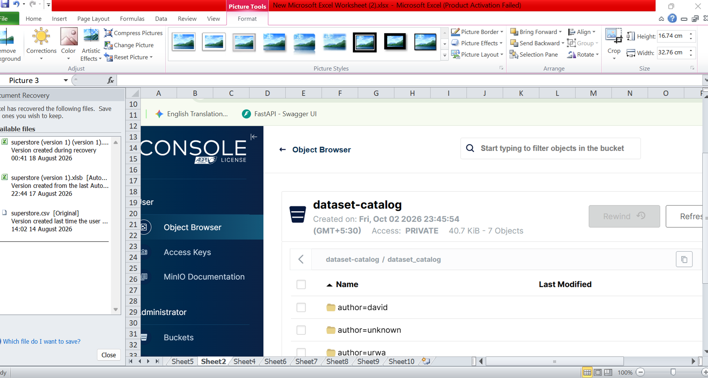
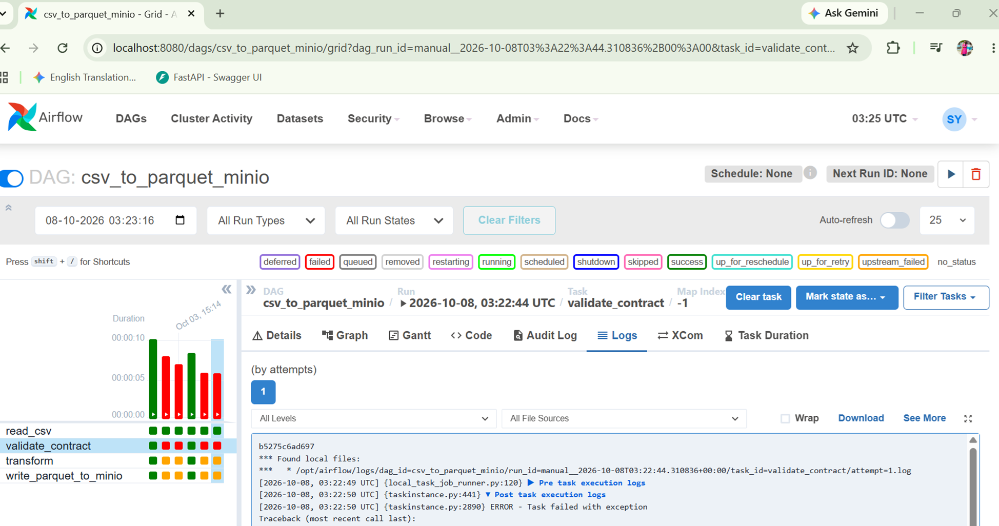

# DHAP-42 — Dataset Catalog CSV → MinIO Parquet Pipeline

## Overview
This project ingests the dataset catalog CSV, validates it against a schema contract, cleans it, and writes it to MinIO as partitioned Parquet using an Airflow DAG. It builds on DHAP-34 (same dataset), but the destination is an object store instead of PostgreSQL, and validation is stricter: the DAG **fails** if the CSV violates the contract. Everything runs locally via Docker Compose.

```
dags/extraction/sample.csv -> read_csv -> validate_contract -> transform -> write_parquet_to_minio
                                              |
                                       FAILS on mismatch
```

## Prerequisites
* Docker & Docker Compose installed
* Git access to the repository

## How to Run
1. Clone this repository and navigate to this folder.
2. Copy `.env.example` to `.env` and fill in real values: `cp .env.example .env`
3. Start the environment: `docker compose up --build`
4. Open the Airflow UI at http://localhost:8080 (username `admin`, password `admin`).
5. Unpause and trigger the DAG `csv_to_parquet_minio`.
6. Open the MinIO console at http://localhost:9001 and log in with `MINIO_ROOT_USER` / `MINIO_ROOT_PASSWORD` from your `.env`.
7. Go to **Object Browser** -> `dataset-catalog` -> `dataset_catalog`. You should see: 
```
   author=david/part-0.parquet
   author=unknown/part-0.parquet
   author=urwa/part-0.parquet
```

[]

## Schema Contract
`schema_contract.yaml` defines, for every column: name, type, nullability and optional value rules (`allowed_values`, `unique`). With `strict_columns: true`, missing or extra columns also fail the run. The DAG reports **all** violations at once, with CSV line numbers.

## Transform
* Column names converted to snake_case (`dataset code` -> `dataset_code`)
* Whitespace stripped, empty strings treated as null
* Fully blank rows removed (the CSV has trailing rows with only a code)
* Null `author` replaced with `unknown` so the partition column is never null

## Parquet Layout
Partitioned by `author` (low cardinality): `dataset-catalog/dataset_catalog/author=<value>/part-0.parquet`.
Re-running overwrites the same partitions, so no duplicate files are created.

## Testing the Contract
A conforming CSV passes. Each of these violations fails `validate_contract`, and `transform` and `write_parquet_to_minio` do not run (nothing is written to MinIO):

| Change in `sample.csv` | Error in the task log |
|---|---|
| Header `author` renamed to `writer` | `Missing columns: ['author']` and `Unexpected columns: ['writer']` |
| `dataset code` value `100` changed to `abc` | `'dataset code': 1 value(s) not integer (CSV lines [2])` |
| `author` value `urwa` changed to `xyz` | `'author': 1 value(s) not in ['urwa', 'david'] (CSV lines [3])` |

[]

## Project Structure
```
dataset_catalog/
  manifest.yaml
  schema_contract.yaml
  docker-compose.yaml
  Dockerfile
  requirements.txt
  .env.example
  dags/
    csv_to_parquet_minio.py
    extraction/sample.csv
```

## Troubleshooting
* **`pull access denied for minio/minio`**: MinIO no longer publishes its images on Docker Hub. This project uses the community fork `pgsty/minio`. If the pinned tag is not found, use `pgsty/minio:latest`.
* **Port 8080, 9000 or 9001 already in use**: stop the other service or change the port mapping in `docker-compose.yaml`.
* **DAG not showing up in UI**: check that `dags/` is mounted in `docker-compose.yaml` and look for Python syntax errors in the DAG file.
* **Connection refused to MinIO**: inside Docker the endpoint is `http://minio:9000`, not `localhost`.
* **`validate_contract` is red**: this is expected when the CSV violates the contract. Open the task log to see which rule failed.
* **Bucket missing**: check the logs of the `minio-init` container.

## Known Limitations
* Re-runs overwrite only the partitions present in the current CSV. If an `author` value disappears from the CSV, its old partition stays in MinIO.
* The Airflow `LocalExecutor` runs all tasks in one container, so tasks pass data through files in `/tmp` rather than XCom. This would need shared storage on a multi-node setup.